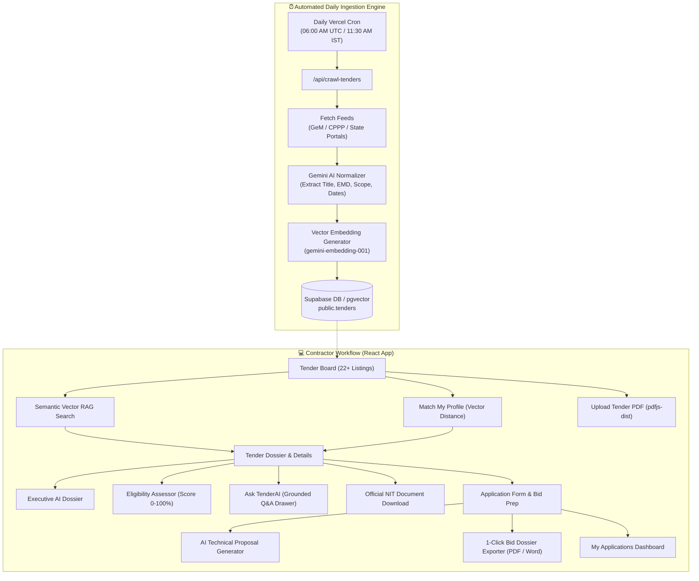

# TenderAI — Smart Government Procurement & Bidding Intelligence Engine

[](https://tender-ai-system.vercel.app)
[](https://react.dev/)
[](https://vitejs.dev/)
[](https://tailwindcss.com/)
[](https://ai.google.dev/)
[](https://supabase.com/)

**TenderAI** is an AI-powered public procurement and bidding intelligence platform built for Indian Government tenders (**GeM**, **CPPP**, **State e-Procurement**, and **PSU portals**). It automates the entire vendor workflow: from daily multi-portal scraping and 3072-dimensional semantic vector discovery to automated eligibility scoring, conversational tender compliance Q&A, and 1-click exportable formal bid dossiers.

---

## 🚀 Key Features

### 1. ⏰ Automated Daily Portal Ingestion Engine
- **Scheduled Cloud Cron (`0 6 * * *`):** Automatically triggered daily at 06:00 AM UTC (11:30 AM IST) via Vercel Cron (`/api/crawl-tenders`).
- **Multi-Portal Ingestion:** Aggregates and deduplicates notices from **GeM (Government e-Marketplace)**, **CPPP eProcurement**, and **State Portals (OSMCL, NHAI, Railways, CPWD)**.
- **AI Schema Normalization:** Gemini automatically extracts structured parameters (NIT Ref, Authority, Scope, Budget, EMD, Turnover thresholds, Deadlines, Penalty clauses).
- **Interactive UI Console:** Monitor active feed health, check last crawl timestamps, and trigger on-demand syncs with a 5-step animated progress tracker.

### 2. ⚡ Vector Semantic RAG Search (`3072-dim`)
- **Semantic Vector Embeddings:** Integrated with Google's `gemini-embedding-001` (with fast local cosine fallback).
- **Natural Language Search:** Move beyond strict keyword queries. Search conceptually:
  > *"Solar streetlights in Odisha under 2 Cr with MSE exemption"*  
  > *"Hospital pediatric X-Ray supply and maintenance contract"*
- **Dynamic Relevance Scoring:** Results are sorted with visual `% Match` similarity badges computed via vector cosine distance.
- **AI Profile Matchmaker:** Automatically vectorizes a contractor's registered company credentials (turnover, experience, certifications, and sectors) to surface the top-matching opportunities.

### 3. 📄 Tender PDF Upload & Regional Parser Engine
- **Client-Side Extraction (`pdfjs-dist`):** Parse multi-page government NIT tender documents directly in the browser without server bottlenecks.
- **Devanagari & Regional Glyph Sanitizer:** Automatically strips unprintable encoding artifacts and mixed Hindi/regional script blocks from scanned documents.
- **Dual-Tab Preview Modal:** Compare raw parsed text against the AI-synthesized Executive Dossier side-by-side before publishing.

### 4. 🧠 Executive AI Dossier & Go/No-Go Recommendation
- Structured executive brief generated for every tender:
  - **Executive TL;DR:** Procuring entity, project summary, and scope.
  - **Commercial Snapshot:** Estimated contract value, EMD amount, and payment milestone terms.
  - **Risk Flags:** Liquidated damages (LD), penalty clauses, inspection audits, and forfeiture terms.
  - **AI Verdict:** Actionable **GO / NO-GO** bidding recommendation based on operational feasibility.

### 5. 💬 Interactive Tender Q&A Assistant ("Ask TenderAI")
- **Grounded Document-Level RAG:** Multi-turn conversational drawer with full conversational memory, citing specific clauses from the selected NIT document.
- **Anti-Hallucination Guardrails:** Strict grounding rules ensure answers are based solely on official tender data.
- **Quick-Query Chips:** One-click shortcuts for instant answers on *EMD & MSME Exemption*, *Liquidated Damages*, *Payment Terms*, *Sub-contracting Rules*, and *Pre-Bid Meeting Dates*.

### 6. 🎯 Automated Bidder Eligibility Assessor
- Evaluates contractor profile against strict NIT qualification criteria:
  - Financial turnover requirement check.
  - Years of demonstrated past performance.
  - Required quality accreditations (ISO 9001, CE, RDSO, CDSCO).
- Outputs a transparent **Eligibility Score (0–100%)**, green-badged matched criteria, missing documents checklist, and strategic mitigation suggestions.

### 7. 📑 1-Click Exportable Tender Bid Dossier (PDF & Word)
- Compiles a complete, formal Indian Government Bid Package:
  1. **Company Letterhead:** Formal firm credentials, GSTIN, PAN, and address.
  2. **Official Cover Letter:** Addressed to the Competent Procurement Authority with NIT reference and quoted bid value.
  3. **Comprehensive Technical Proposal:** AI-generated execution plan, milestone timelines, equipment deployment, and quality guarantees.
  4. **Document Compliance Matrix:** Verification status of all mandatory certificates.
  5. **Statutory Undertakings:** Non-blacklisting declaration, Make-in-India Class-I supplier undertaking, and bid validity commitments.
  6. **Authorized Signatory Block & Official Seal.**
- **Export Formats:** Pristine vector PDF (`window.print()` with `@media print` styling) and editable Microsoft Word (`.doc`).

### 8. 📥 Official Government NIT Document Downloader
- Instant access to the original government tender notice:
  - For uploaded PDFs: downloads the exact original source document.
  - For portal listings: generates an official standardized Government Notice Inviting Tender (NIT) document complete with national emblem styling, BOQ tables, and statutory clauses.

---

## 🏗️ Architecture Overview



---

## 🛠️ Tech Stack

| Layer | Technologies |
| :--- | :--- |
| **Frontend** | React 18, Vite 8, React Router 6, Tailwind CSS v4, Lucide React |
| **AI / LLM** | Google Gemini Flash (`gemini-flash-latest`), Gemini Embeddings (`gemini-embedding-001`) |
| **Parsing & PDF** | `pdfjs-dist` (client-side PDF rendering & text extraction) |
| **Backend & DB** | Supabase (PostgreSQL, Row-Level Security, Auth, `pgvector`), LocalStorage demo fallback |
| **Hosting & Cron** | Vercel Serverless Functions, Vercel Scheduled Cron Jobs (`vercel.json`) |
| **Markdown** | `react-markdown`, `remark-gfm` |

---

## 📁 Repository Structure

```
tender-ai-system/
├── api/
│   └── crawl-tenders.js             # Vercel serverless function & daily cron worker
├── src/
│   ├── assets/                      # Brand assets and graphics
│   ├── components/
│   │   ├── AIDossier.jsx            # Executive AI brief & Go/No-Go verdict
│   │   ├── AppLayout.jsx            # Responsive navigation & sidebar shell
│   │   ├── BidDossierModal.jsx      # 1-Click Formal Bid Package (PDF / Word)
│   │   ├── EligibilityReport.jsx    # Real-time criteria scoring & gap analysis
│   │   ├── IngestionEngineModal.jsx # Multi-portal crawler status & sync UI
│   │   ├── Logo.jsx                 # Platform typography & branding
│   │   ├── MarkdownRenderer.jsx     # GitHub-flavored Markdown formatter
│   │   ├── ProfileMatchModal.jsx    # Vector RAG contractor matchmaker
│   │   ├── ProtectedRoute.jsx       # Auth guard wrapper
│   │   ├── Seal.jsx                 # Status badges & security stamps
│   │   ├── TenderQADrawer.jsx       # Grounded interactive Q&A assistant
│   │   └── UploadTenderModal.jsx    # PDF upload & regional sanitization
│   ├── context/
│   │   └── AuthContext.jsx          # Supabase auth + local session demo mode
│   ├── lib/
│   │   ├── api.js                   # Unified data access layer (Supabase + cache)
│   │   ├── dossierExporter.js       # Official NIT & Word (.doc) generator
│   │   ├── gemini.js                # Gemini API client, fallbacks, & Q&A engine
│   │   ├── mockTenders.js           # 22+ comprehensive master government tenders
│   │   ├── pdfExtractor.js          # pdfjs-dist regional text extraction
│   │   ├── portalIngestion.js       # GeM & CPPP crawling & AI structuring
│   │   ├── supabaseClient.js        # Supabase client initialization
│   │   └── vectorSearch.js          # 3072-dim embeddings & cosine similarity
│   ├── pages/
│   │   ├── ApplicationForm.jsx      # Bid application & proposal drafting
│   │   ├── Applications.jsx         # "My Applications" bid tracking board
│   │   ├── Dashboard.jsx            # Tender Board with AI Semantic Search
│   │   ├── Login.jsx                # Authentication login screen
│   │   ├── Onboarding.jsx           # Company profile & turnover setup
│   │   ├── Signup.jsx               # New vendor registration screen
│   │   └── TenderDetail.jsx         # Tender dossier & specification breakdown
│   ├── App.jsx                      # App route definitions
│   ├── index.css                    # Tailwind CSS v4 + @media print styles
│   └── main.jsx                     # Vite React entrypoint
├── supabase/
│   └── schema.sql                   # Database tables, RLS policies, & pgvector RPC
├── vercel.json                      # Scheduled daily cron & SPA routing configuration
├── package.json
└── README.md
```

---

## ⚙️ Local Development Setup

### 1. Prerequisites
- **Node.js** (v18 or higher)
- **npm** or **pnpm**
- A **Google Gemini API Key** ([Google AI Studio](https://aistudio.google.com/))

### 2. Clone the Repository
```bash
git clone https://github.com/anagh-guptaa/tender-ai-system.git
cd tender-ai-system
```

### 3. Install Dependencies
```bash
npm install
```

### 4. Configure Environment Variables
Create a `.env` file in the project root:
```env
# Gemini API Key (Required for live AI dossiers, Q&A, and Vector Embeddings)
VITE_GEMINI_API_KEY=your_gemini_api_key_here

# Supabase Credentials (Optional — runs out-of-the-box in demo mode if omitted)
VITE_SUPABASE_URL=https://your-project.supabase.co
VITE_SUPABASE_ANON_KEY=your_supabase_anon_key_here
```

### 5. Start Development Server
```bash
npm run dev
```
Open **[http://localhost:5173](http://localhost:5173)** in your browser.

---

## 🗄️ Database Setup (Supabase)

To connect real persistence and vector search:
1. Create a project at [supabase.com](https://supabase.com).
2. Go to the **SQL Editor** and execute the contents of [`supabase/schema.sql`](./supabase/schema.sql).
3. The schema sets up:
   - `public.companies` (Vendor profiles with RLS)
   - `public.tenders` (Procurement listings + `embedding vector(3072)`)
   - `public.applications` (Tracked vendor bid submissions)
   - `public.eligibility_reports` (Cached AI compliance reports)
   - `public.match_tenders()` (Vector cosine distance RPC function)

---

## 🚢 Deployment to Vercel

The project is pre-configured for Vercel deployment:
1. Push your code to your GitHub repository.
2. Import the repository in your [Vercel Dashboard](https://vercel.com).
3. Add `VITE_GEMINI_API_KEY` (and optionally Supabase credentials) under **Project Settings $\rightarrow$ Environment Variables**.
4. Deploy! Vercel automatically reads `vercel.json` to register the **Daily Cron Job** and configure SPA route rewrites.

---

## 📜 License

This project is licensed under the **MIT License**.
